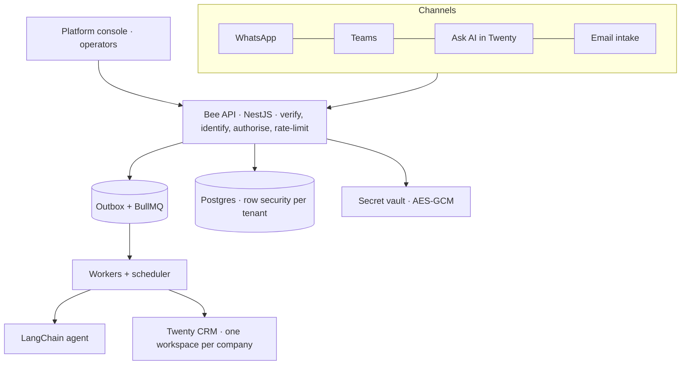
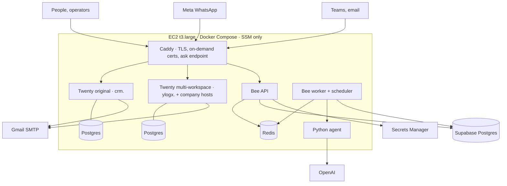

# CRM Bee — architecture, deployment, rationale, production path

## 1. Logical architecture

Request path: a channel message is verified (signature/secret), the sender is resolved to a **person** in a **tenant**,
the role matrix is applied, and the work is written to the **transactional outbox** before the HTTP call returns.
Workers pick jobs up from BullMQ, ask the agent to extract/decide, show a **draft** for confirmation, and only then
write to Twenty. Every step is audited per tenant.

## 2. Deployment architecture (AWS, today)

* Public surface is only Caddy (80/443). Bee exposes `/webhooks/*` and `/health`; admin, chat relay, metrics and the
  TLS-ask endpoint are internal.
* Releases: `release.sh` bundles `git archive HEAD` to a private S3 bucket and rolls it out through SSM; config lives in
  Secrets Manager (`crmbee/env`).
* Companies: `<slug>.<base>` on the multi-workspace Twenty, certificates issued on first use for names Bee approves.

## 3. Why this is a good design

| Decision | Why |
|---|---|
| Twenty stays the system of record; Bee is a conversational layer | No CRM fork to maintain; upgrades of Twenty are independent; the BRD's "native Twenty screens for CXO/admin" stays true |
| Workspace per company + `tenant_id` row security in Bee | Two independent isolation layers; a bug in one does not leak data |
| Transactional outbox + BullMQ | A confirmed capture is never lost between "saved" and "queued"; retries and replay are idempotent |
| Draft → confirm → write | The model never changes the CRM on its own; humans approve; audit shows who confirmed |
| Capability matrix + separate operator principal | Operators run the service without seeing customer records; support access is client-approved, time-boxed, audited |
| Per-tenant derived secrets, vault with AES-GCM | A credential from tenant A cannot speak for tenant B; nothing per tenant is stored in plaintext config |
| Stateless API/worker containers | Scale out by adding copies; deploys are replace-and-restart |
| One-host Compose behind Caddy | Cheap, reproducible, no cluster to operate while the product is proven |
| SSM instead of SSH; secrets in Secrets Manager | No open admin port; no secrets in images or user-data |

## 4. Improving it for production

**Availability and scale**
1. Move Bee API/worker/scheduler to **ECS Fargate (or EKS)** behind an **ALB**; keep Caddy only if on-demand TLS is
   still needed, otherwise ACM wildcard certificate + Route 53 on a real domain (replace sslip.io).
2. **Managed data stores**: RDS/Aurora for Twenty's databases, ElastiCache for Redis (AOF on for Bee's queue), multi-AZ.
   Twenty stays 1 server + 1 worker per instance; add a second multi-workspace Twenty when the licence cap is reached.
3. Separate **worker pools per queue** (AI, CRM writes, outbound) with autoscaling on queue depth; per-tenant fair
   scheduling (BRD TEN-05) instead of FIFO.

**Security and compliance**
4. Obtain a Twenty **Organization key** (lifts the 5-workspace cap and enables enterprise features).
5. WAF in front, private subnets for everything except the load balancer, VPC endpoints for S3/Secrets Manager,
   KMS-encrypted volumes and snapshots, secret rotation, audit-log export to immutable storage (S3 Object Lock).
6. Per-tenant WhatsApp numbers/tokens (`channels.whatsapp.accessTokenRef` exists), SSO for operators, MFA enforced.

**Operations**
7. Observability: OpenTelemetry traces to a collector, dashboards and alerts on queue lag, dead letters, webhook
   failures, channel health, Twenty latency; uptime checks per company host.
8. Backups with **restore drills** (Postgres PITR, Twenty file storage), tested tenant relocation, runbooks.
9. CI/CD: build once, sign image, deploy blue/green with automatic rollback; run the live platform verification
   (`scripts/verify/platform.mjs`) as a post-deploy gate in staging.
10. Load and soak tests against the BRD targets (30-minute sustained load, 99.5 % availability), plus the extraction
    accuracy evaluation on a real corpus.

**Product**
11. Operator console additions: remove/offboard company, usage-based limits and billing hooks, per-company health
    history, bulk user import.
12. Live WhatsApp/Teams enrolment flows hardened with Meta-approved templates and opt-out handling.
